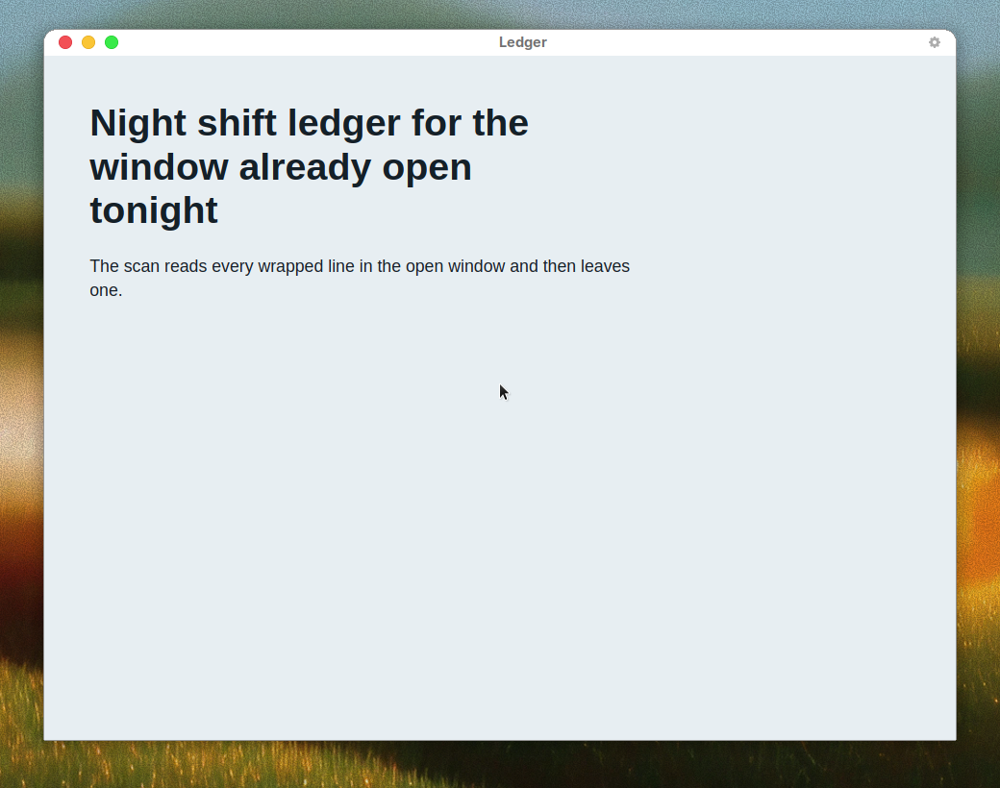
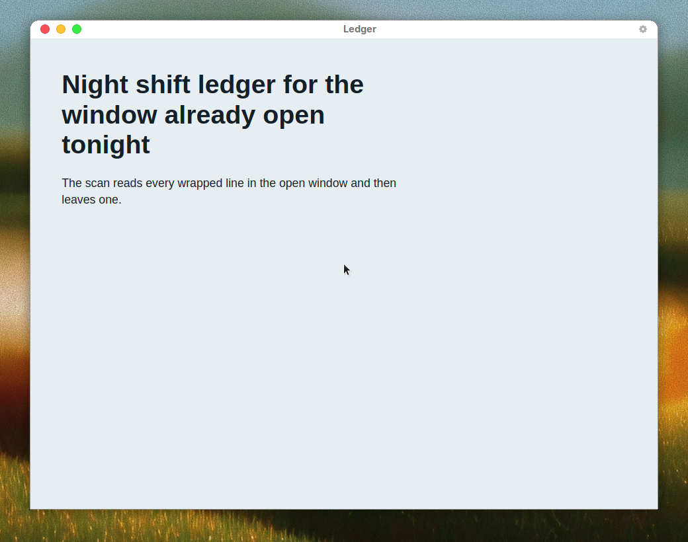

# Scan an Electron window with Impeccable

Impeccable 4.7.0 reads a Chromium window that is already open. Ledger is a small Electron app with one heading and one paragraph. The heading's last line is the word "tonight". The paragraph's last line is the word "one."

A file scan of this folder does not report those two breaks. `impeccable detect --cdp 9222` does, because it reads the rendered lines.

## Run the scan

Install the CLI once, away from the recording.

```bash
npm install -g --prefix "$HOME/.local" impeccable@4.7.0
```

From this folder, install Electron and start the window.

```bash
npm install
npm start
```

`npm start` runs `electron . --remote-debugging-port=9222`. On Linux, if no window appears, start it this way instead.

```bash
npx electron . --remote-debugging-port=9222 --no-sandbox --disable-gpu
```

In a second terminal, scan the open window.

```bash
impeccable detect --cdp 9222
```

The run on 2026-10-25 printed two advisory notes and exited 0.

```text
[unbalanced-heading] last of 3 lines is 33% as wide as the line above
[straggler] "one." alone on the last of 2 lines (6% of the measure)
```

The scan does not change the page. `git diff -- page electron` stays empty.



## Apply one fix

Add `text-wrap: pretty` to the `p` rule in `page/demo.css`. Reload the Ledger window. Run the same detect command.

`straggler` is gone. `unbalanced-heading` stays. `text-wrap: pretty` pulls a word down beside the lonely last word. It does not even out a heading. The heading fix the detector names is `text-wrap: balance`. This demo does not apply that fix.

After the declaration, the paragraph's second line reads "leaves one." The heading still ends on "tonight".



The committed `page/demo.css` is the page before the fix. Remove the declaration if you applied it and you want that page back.

## Sources

- [Impeccable CLI 4.7.0](https://github.com/pbakaus/impeccable/releases/tag/cli-v4.7.0) adds `--cdp` for a local DevTools port and ships detector engine 0.1.16.
- [Impeccable skill 4.7.0](https://github.com/pbakaus/impeccable/releases/tag/skill-v4.7.0) names `straggler` and `unbalanced-heading`, and says `text-wrap: balance` and `text-wrap: pretty` stand a finding down where that value fixes it.

## Limits

- The scan does not edit the source.
- The shipped page does not include the fix.
- A file scan does not report these two rules. They need the open window.
- The demo does not set `text-wrap: balance`, so the heading advisory remains.
- On Linux the window can need `--no-sandbox` and `--disable-gpu`.
- This take does not cover NW.js, CEF, or WebView2.
- Both findings are advisory. They do not change the exit code.
