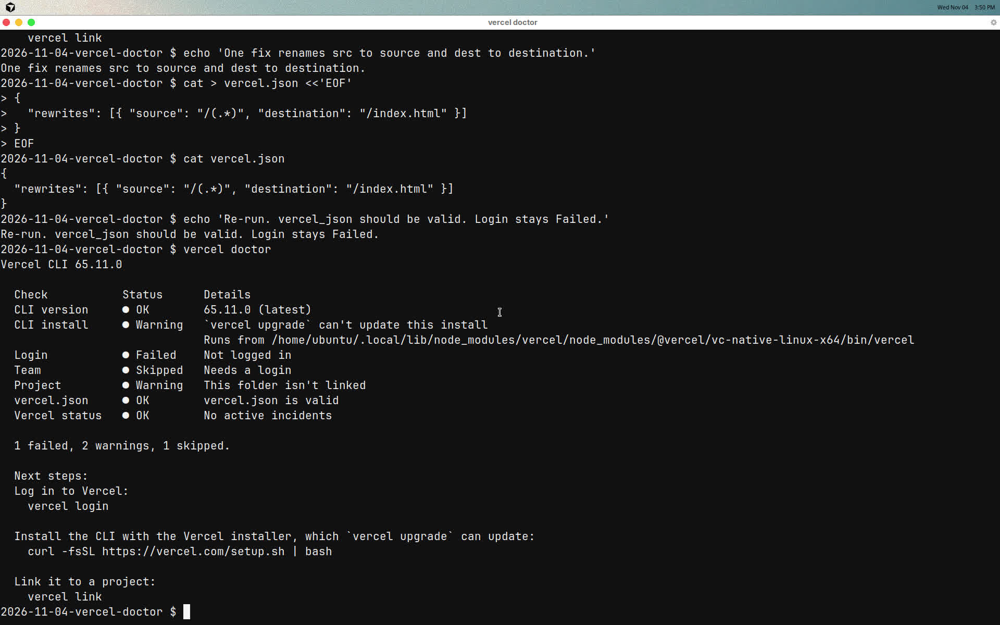

# Diagnose a broken `vercel.json` with `vercel doctor`

Vercel CLI 65.11.0 adds `vercel doctor`. It reads this folder and prints one line per check. The shipped `vercel.json` uses the old rewrite keys `src` and `dest`. The `vercel_json` check fails on `src` and suggests `source`. A rename of `src` alone still fails, this time on `dest`. The one fix changes both keys.

Doctor does not need a login. This machine is logged out, so Login stays Failed. Do not treat that row as the demo fail.

## Run the diagnosis

Install the CLI once, away from the recording, at the version this take used.

```bash
npm install -g --prefix "$HOME/.local" vercel@65.11.0
export PATH="$HOME/.local/bin:$PATH"
```

From this folder, run doctor. Do not log in, link, or deploy.

```bash
vercel doctor
```

The dry run on 2026-11-04 printed this table and exited 0.

```text
Check	Status	Details
CLI version	OK	65.11.0 (latest)
CLI install	Warning	`vercel upgrade` can't update this install
Login	Failed	Not logged in
Team	Skipped	Needs a login
Project	Warning	This folder isn't linked
vercel.json	Failed	vercel.json has an error; `rewrites[0]` should NOT have additional property `src`. Did you mean `source`?
Vercel status	OK	No active incidents

  2 failed, 2 warnings, 1 skipped.
```

The CLI install Warning also printed the path of this npm prefix install. Yours will name your path.

`git diff -- vercel.json` stays empty. Doctor only reads the file.

![First doctor run. vercel.json failed on rewrites[0].src. Login failed as Not logged in.](screenshots/doctor-before.jpg)

## Apply one fix

In `vercel.json`, rename `src` to `source` and `dest` to `destination`. Leave every other check alone.

```json
{
  "rewrites": [{ "source": "/(.*)", "destination": "/index.html" }]
}
```

Run the same command again.

```bash
vercel doctor
```

On 2026-11-04 the second run reported `vercel.json` OK with `vercel.json is valid`. Login still Failed. Team still Skipped. Project still Warning. Exit code stayed 0. The summary line was `1 failed, 2 warnings, 1 skipped.`



The committed `vercel.json` is the broken specimen. Put the old keys back if you applied the fix and you want that file as shipped.

## Watch the take

The recording is 65 seconds. Captions are `echo` lines in the picture. There is no voice track. It runs doctor, applies the two-key rename, and ends on the second run with `vercel.json` OK and Login still Failed.

[recording.mp4](recording.mp4)

## Sources

- [Diagnose Vercel CLI setup problems with vercel doctor](https://vercel.com/changelog/vercel-cli-now-diagnoses-setup-problems-with-vercel-doctor) is the 2026-11-03 changelog for this command.
- [vercel doctor](https://vercel.com/docs/cli/doctor) is the command reference.
- [Vercel CI no longer requires a linked Vercel project](https://vercel.com/changelog/vercel-ci-no-longer-requires-a-linked-vercel-project) is related. This demo does not run Vercel CI.

## Limits

- Never paste fake doctor output. The terminal in the take is the proof.
- No `vercel login`, `vercel link`, or `vercel deploy`.
- Login Failed is honest. This demo does not clear it.
- Doctor exits 0 even when checks fail.
- Only the `vercel.json` check is the intentional fail and the intentional clear.
- Changing `src` and leaving `dest` still fails `vercel.json`.
- The CLI install Warning stays on an npm prefix install. This demo does not reinstall through `vercel upgrade`.
- The shipped tree is the broken JSON. The recording applies the fix, then the source is restored off camera.
